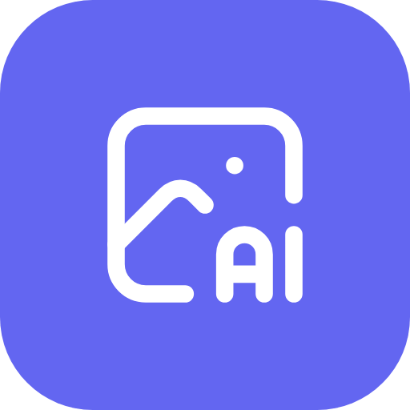
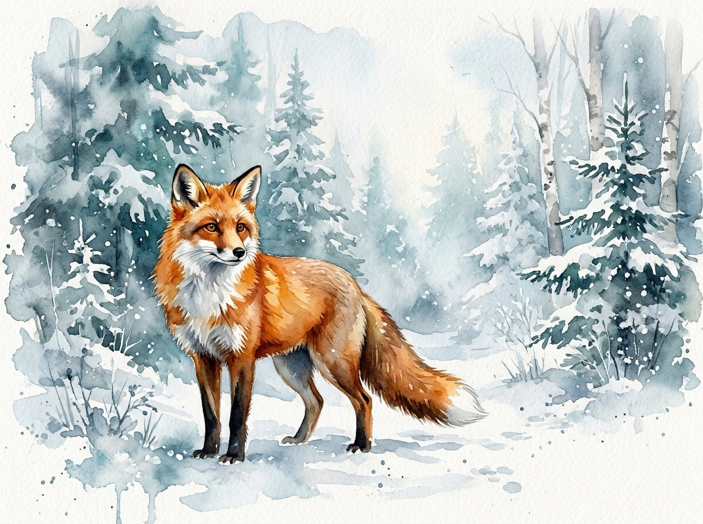

<div align="center">



# agy-imagegen

**One `image-generation` skill for Claude Code, Codex and Antigravity. Gemini or OpenAI, your choice.**

Ask for an image in plain English. Get a file on disk.


</div>

---

## What it does

`agy-imagegen` teaches your coding agent to generate images and save them exactly where you want. It adapts to the agent it runs in:

| You are in | Image backend | How |
| --- | --- | --- |
| **Claude Code** | **You choose**: Gemini (`agy`), OpenAI via API key (`openai`), OpenAI via Codex (`codex`), a local server (`local`), or `auto` | Claude asks (or uses `IMAGEGEN_BACKEND`) and runs the helper script headlessly |
| **Antigravity (`agy`)** | Defaults to **OpenAI** (`openai` or `codex`); Gemini via agy's own tool on request | The skill brings the other model into agy |
| **Codex** | Defaults to **Gemini** (`agy` backend); Codex's own `$imagegen` on request | The skill brings the other model into Codex |

> *"Make an image of a red fox in a snowy forest, watercolor style."*

<div align="center">

<br /><sub>Generated by this skill from the prompt above.</sub>
</div>

If you don't say where to save, it picks a sensible default folder and a readable filename, so the image never ends up lost in an internal cache.

### New in 1.2

- **Cross-model in every agent:** in Antigravity the skill gives you the OpenAI model, in Codex it gives you Gemini (native tools stay available on request).
- **`openai` backend + sign-in:** no Codex needed. Run the script once with `-Login` and paste your OpenAI API key (hidden input, verified against the API, stored encrypted for your Windows account only). `-Logout` removes it. `OPENAI_API_KEY` in the environment also works and takes priority.
- **`local` backend:** any OpenAI-compatible local image server via `IMAGEGEN_LOCAL_URL`.
- **`auto` backend:** let the agent pick among the backends you enable with `IMAGEGEN_BACKENDS` (e.g. `agy,openai`).
- **Bulk:** `-Count 4` or `-BatchFile prompts.txt`.
- **Reference images:** `-Reference "a.png|b.jpg"` for inspiration or edits.

**Tested:** the `agy` backend, bulk, `auto`, reference images and the MCP tool.

**Known limitation (Codex backend):** tried with Codex CLI 0.166.0 signed in with a ChatGPT account, headless `codex exec` exposed **no image-generation tool** (it answered that none was available, on three different models), even though the `image_generation` feature flag is on. So the `codex` backend currently fails fast with Codex's own message on that setup. Use the `openai` backend (API key) for OpenAI images instead. Whether `codex exec` can generate images with an API-key sign-in is untested.

**Untested:** the `openai` backend against the real API (no key available here; `-Login` storage, read-back, rejection of a bad key and `-Logout` were tested with a dummy value) and a real `local` server.

## How it works

The helper script, `generate-image.ps1`, has three modes:

| Mode | What it does |
| --- | --- |
| *(default)* | Runs the chosen backend **headlessly** (no window, no keyboard-focus stealing), waits for the image, saves it |
| `-FromFile <path>` | Saves an image another tool already made (agy's or Codex's built-in image tool) to your path, converting format if needed |
| `-Check` | Reports which backends are installed |

- **agy:** runs `agy -p "<prompt>" --output-format json`, reads the conversation id from the JSON and picks the image up from agy's working folder.
- **codex:** runs `codex exec` in a scratch folder, asks Codex's built-in `$imagegen` to save the file there, and falls back to Codex's own generated-images store (see the known limitation above).
- **openai:** calls the OpenAI Images API (`/images/generations`, or `/images/edits` when you pass reference images) with `OPENAI_API_KEY`.
- **local:** the same API shape against `IMAGEGEN_LOCAL_URL`, for any OpenAI-compatible local image server.
- **auto:** picks one of the backends you enabled (`IMAGEGEN_BACKENDS`): text, logos, layouts and edits go to OpenAI first, everything else to Gemini first.

### Why not just `--dangerously-skip-permissions`?

Built-in image tools save into the agent's own private folder, so getting the file to *your* path normally needs the agent to run a shell copy, which headless mode auto-denies. The obvious workaround is a permission bypass, which hands an AI agent unrestricted command access just to copy a file.

This project avoids that: the agent only generates the image, and the wrapper script does the copy itself. **No permission bypass, no full-access sandbox, no GUI automation, no keystroke injection.**

## Requirements

- Windows 10/11 with PowerShell 5.1+ (or PowerShell 7)
- At least one image backend, installed **and signed in**:
  - [Antigravity CLI](https://antigravity.google) (`agy`) for Gemini. Run `agy` once interactively to log in.
  - An OpenAI API key for OpenAI images through the API (the `openai` backend): sign in once with `-Login`, or set `OPENAI_API_KEY`. Or
  - [Codex CLI](https://developers.openai.com/codex) (`codex`, found on `PATH` or in the Codex desktop app's folder); see the known limitation above.
  - Optionally a local OpenAI-compatible image server (`IMAGEGEN_LOCAL_URL`).
- An agent to run the skill in: [Claude Code](https://claude.com/claude-code), Codex or Antigravity
- Node.js 18+ (only for the optional MCP server)

## Install

### Antigravity (agy)

From a clone of this repo:

```powershell
git clone https://github.com/Jesse-Voo/agy-imagegen
agy plugin install .\agy-imagegen\plugins\agy-imagegen
```

Then ask agy for an image. It uses its own image tool and the skill places the file where you asked. In an interactive session agy asks you to approve the final copy command. In headless mode (`agy -p`) that approval can't be given, so the image is generated but stays in agy's own folder unless you add an allow rule for the helper script to agy's `permissions.allow` settings.

### Claude Code (recommended)

```text
/plugin marketplace add Jesse-Voo/agy-imagegen
/plugin install agy-imagegen@agy-imagegen
```

Then just ask Claude for an image. If both `agy` and `codex` are installed and you didn't say which, Claude asks.

### Codex

```bash
codex plugin marketplace add Jesse-Voo/agy-imagegen
codex plugin add agy-imagegen@agy-imagegen
```

Then restart Codex. (`codex plugin list` shows what is installed.) To enable it for one project instead, add this to that repo's `.codex/config.toml`:

```toml
[plugins."agy-imagegen@agy-imagegen"]
enabled = true
```

> The Codex manifest follows OpenAI's published plugin spec; installing it through `codex plugin` has not been tested yet. In Codex the skill brings in Gemini through the `agy` backend, which needs the Antigravity CLI installed and signed in.

### As a plain skill

Copy the skill folder into your agent's skills directory (Claude Code shown):

```powershell
git clone https://github.com/Jesse-Voo/agy-imagegen
Copy-Item -Recurse agy-imagegen\plugins\agy-imagegen\skills\image-generation $HOME\.claude\skills\
```

### On claude.ai

claude.ai skills run in a cloud sandbox that has neither your PC nor `agy`/`codex`, so this skill can't generate images there. It needs an agent running locally on your machine.

### As an MCP server (optional)

For clients that speak MCP but not skills:

```powershell
cd agy-imagegen\plugins\agy-imagegen\mcp
npm install
claude mcp add generate-image -- node "$PWD\index.js"
```

This exposes one tool, `generate_image(description, output_path?, backend?)`, which runs the same script.

## Usage

### From your agent

Just ask:

- *"Generate a logo for my coffee shop, flat vector style."*
- *"Draw a cozy cabin at night and save it to `C:\Users\me\Pictures\cabin.png`."*
- *"Make a pixel-art sword with OpenAI/Codex."* (Claude Code picks the backend you name.)

### Signing in to OpenAI (for the `openai` backend)

```powershell
& $gen -Login     # paste your API key once (platform.openai.com/api-keys)
& $gen -Check     # shows: openai: available (saved sign-in ...)
& $gen -Logout    # remove the saved key
```

This is a key-based sign-in: OpenAI does not offer a "Sign in with ChatGPT" flow for third-party tools to the Images API, so the script never touches Codex's or ChatGPT's own tokens. The key is encrypted with Windows DPAPI (readable only by your Windows user) in `%APPDATA%gy-imagegen\openai.key`. For a piped sign-in, send the key on stdin: `$key | & $gen -Login`.

### From PowerShell

```powershell
$gen = ".\plugins\agy-imagegen\skills\image-generation\scripts\generate-image.ps1"

# What's installed?
& $gen -Check

# Save to the default folder, auto-named (default backend)
& $gen -Description "a red fox in a snowy forest, watercolor style"

# Pick the backend and a specific file (format follows the extension)
& $gen -Backend codex -Description "a neon city skyline" -OutputPath "$HOME\Pictures\city.jpg"

# Save into a folder, auto-named
& $gen -Description "a paper boat" -OutputPath "$HOME\Desktop"

# Place an image another tool already generated
& $gen -FromFile "C:\path\to\generated.jpg" -Description "a paper boat" -OutputPath "$HOME\Pictures\boat.png"
```

The saved path is printed as the last line of output.

### Parameters

| Parameter | Required | Description |
| --- | --- | --- |
| `-Description` | yes (unless `-FromFile` or `-Check`) | What the image should show. Be specific about subject and style. |
| `-OutputPath` | no | File path, or an existing folder. `.png`, `.jpg`/`.jpeg`, `.bmp`, `.gif`. Missing folders are created. |
| `-Backend` | no | `agy`, `codex`, `openai`, `local` or `auto`. Default: `IMAGEGEN_BACKEND`, else `agy`. |
| `-Count` | no | Make N variations of `-Description` (1-10). |
| `-BatchFile` | no | Text file, one description per line (max 20). |
| `-Reference` | no | Existing image(s) as inspiration or to edit; separate several with `\|`. |
| `-FromFile` | no | Save an existing image instead of generating one. |
| `-Check` | no | Print which backends are installed and exit. |
| `-Login` / `-Logout` | no | Save / remove your OpenAI API key for the `openai` backend (`-NoVerify` skips the check call). |
| `-TimeoutSeconds` | no | Give up after this long. Default `300`. |

### Configuration (environment variables, all optional)

| Variable | Default | Purpose |
| --- | --- | --- |
| `IMAGEGEN_BACKEND` | `agy` | Default backend: `agy`, `codex`, `openai`, `local` or `auto` |
| `IMAGEGEN_BACKENDS` | all available | Backends `auto` may choose from, e.g. `agy,openai` |
| `OPENAI_API_KEY` | none | Enables the `openai` backend (overrides a saved `-Login` key) |
| `OPENAI_IMAGE_MODEL` | `gpt-image-2` | Model for the `openai` backend |
| `OPENAI_BASE_URL` | `https://api.openai.com/v1` | API base URL |
| `IMAGEGEN_LOCAL_URL` | none | Base URL of a local OpenAI-compatible image server (enables `local`) |
| `IMAGEGEN_LOCAL_MODEL` | none | Model name sent to the local server |
| `AGY_IMAGE_DIR` | `<Pictures>\Generated` | Default save folder when no path is given |
| `AGY_EXE` | `agy` on `PATH`, else `%LOCALAPPDATA%\agy\bin\agy.exe` | Path to the Antigravity CLI |
| `AGY_BRAIN_DIR` | `~\.gemini\antigravity-cli\brain` | Where agy keeps generated images |
| `CODEX_EXE` | `codex` on `PATH`, else the Codex desktop app's CLI | Path to the Codex CLI |
| `CODEX_HOME` | `~\.codex` | Codex's home folder (fallback image store) |

## Repository layout

```text
agy-imagegen/
├── .claude-plugin/marketplace.json   # Claude Code marketplace
├── .agents/plugins/marketplace.json  # Codex marketplace
├── plugins/agy-imagegen/             # the plugin (shared by all three agents)
│   ├── .claude-plugin/plugin.json    # Claude Code manifest
│   ├── .codex-plugin/plugin.json     # Codex manifest
│   ├── .antigravity-plugin/plugin.json  # Antigravity manifest
│   ├── skills/image-generation/
│   │   ├── SKILL.md                  # tells the agent which flow to use
│   │   └── scripts/generate-image.ps1
│   └── mcp/                          # optional MCP server wrapping the script
└── assets/                           # logo and example output
```

## Troubleshooting

| Symptom | Fix |
| --- | --- |
| `agy not found` / `codex not found` | Install that CLI, or set `AGY_EXE` / `CODEX_EXE`. Run `-Check` to see what is detected. |
| `agy returned no usable JSON` | Run `agy` once interactively and sign in. |
| `No image produced by codex` (Codex says it has no image tool) | Headless `codex exec` doesn't expose image generation on every setup. Use `-Backend openai` with an API key instead. |
| `Not signed in to OpenAI` | Run the script with `-Login` once, or set `OPENAI_API_KEY`. |
| `No image appeared in ...` | The backend answered but didn't generate an image. Try rewording the description. |
| agy generated the image but it isn't at my path | Headless agy can't approve the copy command. Use the interactive session, or call the script directly. |
| Script blocked by execution policy | Run with `powershell -ExecutionPolicy Bypass -File ...` or adjust your policy. |
| Timeout | Raise `-TimeoutSeconds`. Generation usually takes 30-90 s. |

## Notes

- Images are generated by Google's Gemini through your own Antigravity account, or by OpenAI's `gpt-image-2` through your own Codex account; usage and limits are governed by their terms.
- This project is unofficial and is not affiliated with Google, OpenAI or Anthropic.
- The logo is the [Tabler Icons](https://tabler.io/icons) `photo-ai` icon (MIT) via [Iconify](https://iconify.design).
- These CLIs are young and their flags may change. If something breaks after an update, please open an issue.

## License

[MIT](LICENSE)
